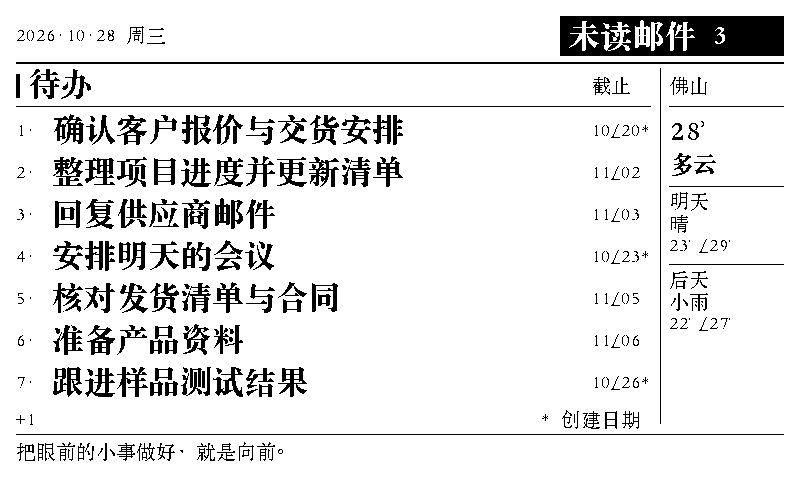

# E-Ink Briefing · 墨屏日报

给墨水屏用的中文待办看板。Cloudflare Workers 在云端生成黑白位图，设备直接取图；网页预览使用同一张位图。



## 功能

- **待办优先**：飞书原生任务同步，包含负责、创建、分配和关注的未完成任务；按创建时间从旧到新固定显示。
- **紧凑排版**：宋体、简短日期和截止列，长标题最多两行，放不下的显示 `+N`。`*` 表示创建日期，其他日期为截止日期。
- **未读邮件**：只显示飞书收件箱未读数量，不请求或保存邮件主题、发件人、正文和附件。
- **次要天气**：Open-Meteo 当前天气与明后天预报，未来预报使用较轻字重。
- **每日一句**：120 条原创短句，按中国日期每天轮换。
- **账号保护**：单管理员 Passkey；首次用强密码登录，绑定 Passkey 后默认关闭密码登录。
- **私密存储**：待办、配置、邮件数量和飞书授权凭据使用 AES-256-GCM 加密。设备使用独立密钥取图。
- **云端自动更新**：每两分钟同步飞书，无需电脑持续开机；失败保留上次快照并提示异常。
- **正确刷新**：缓存版本取决于实际像素，未变化返回 304；布局、字体、数据或强制刷新变化会返回新图。

## 架构

```text
飞书任务 / 邮件 ── 定时同步 ──> Cloudflare Worker + OwnerAuth Durable Object
                                      │
                                 加密 KV 存储
                                      │
                               同一个位图渲染器
                                /             \
                        墨水屏原始字节       后台 BMP 预览
```

项目提供云端服务和后台，不包含硬件固件。设备需支持本文的位图协议；与 [esonwong/e-ink-todo-list](https://github.com/esonwong/e-ink-todo-list) 的服务端位图方式对接时，请按所用固件确认尺寸和刷新设置。

## 开始使用

需要 Node.js 22 或更新版本、Python 3 + Pillow、Cloudflare 账号，以及支持中文的**有合法使用权限的字体**。开启飞书功能还需要自建应用。

```bash
cd cloudflare
npm ci
python3 -m pip install Pillow
python3 gen_font.py 32
python3 gen_font.py 24
python3 gen_font.py 20
npm test
npm run build
```

默认字体生成器使用 macOS 自带宋体。其他系统可指定自己的中文字体，例如：

```bash
EINK_FONT_PATH=/path/to/your/licensed-font.ttf EINK_FONT_FACE=0 python3 gen_font.py 32
EINK_FONT_PATH=/path/to/your/licensed-font.ttf EINK_FONT_FACE=0 python3 gen_font.py 24
EINK_FONT_PATH=/path/to/your/licensed-font.ttf EINK_FONT_FACE=0 python3 gen_font.py 20
```

仓库不分发系统字体或生成的字体点阵。不同字体的字重和覆盖范围可能不同，部署前请检查显示效果。手工新增生僻字时，也需扩充生成器的字库范围。

### 部署

完整步骤见 [部署指南](docs/DEPLOYMENT.md)。概览：

1. 复制 `cloudflare/wrangler.example.toml` 为 `cloudflare/wrangler.toml`。
2. 新建自己的 KV namespace，填写自己的域名、KV ID 和飞书 App ID。
3. 通过 Wrangler Secrets 设置 `ADMIN_PASSWORD`、`DEVICE_TOKEN`、`DATA_ENCRYPTION_KEY`；密钥不要写进配置文件。
4. 部署后进入 `/admin`，首次密码登录并绑定 Passkey。
5. 按需配置飞书，然后在后台点击“连接飞书待办”完成本人授权。

生产域名、KV ID、飞书 App ID/Secret、邮箱、密码、加密密钥及授权凭据均需由部署者自行配置。本仓库不含作者的生产配置和个人数据。

## 设备位图协议

```http
GET /api/display/v2?width=800&height=480
Authorization: Bearer <your-device-token>
```

- 响应为行优先、MSB-first 的 1-bit 原始位图；`1` 为黑色，`0` 为白色。
- 每行 `ceil(width / 8)` 字节；800×480 为 48,000 字节。
- 响应包含 `Content-Picture-Width`、`Content-Picture-Height`、`Last-Modified` 和 `ETag`。
- 设备可携带 `If-Modified-Since` 或 `If-None-Match`；未变化时返回 304。
- 后台 `/api/display/preview` 用同一渲染器生成无损 BMP，需要管理员会话。
- 强制刷新在设备下一次联网取图时生效。

## 开发与测试

```bash
cd cloudflare
npm test
npm run build
npx wrangler deploy --dry-run
```

测试覆盖 Passkey 签名/来源/重放保护、会话和权限、加密篡改检测、同步分页与失败恢复、刷新缓存、浏览器与设备逐像素一致，以及紧凑版面。

`node test/ui-server.js` 可启动只含内存测试数据的本地交互服务。它不连接你的真实飞书；测试密码只用于此服务。不要将这个测试服务暴露到公网。

## 文件说明

| 文件 | 用途 |
| --- | --- |
| `cloudflare/worker.js` | 路由、天气与展示状态 |
| `cloudflare/auth.js` | 管理员认证、OAuth 与内部协调 |
| `cloudflare/private-kv.js` | 私密 KV 加密层 |
| `cloudflare/task-sync.js` | 飞书用户任务同步 |
| `cloudflare/mail-sync.js` | 飞书未读邮件数量同步 |
| `cloudflare/renderer.js` | 纯 JavaScript 位图排版 |
| `cloudflare/gen_font.py` | 本地字体点阵生成 |
| `cloudflare/public/` | 后台、设备画面预览 |
| `cloudflare/test/` | 自动化检查和内存测试服务 |

显示约定见 [DESIGN.md](DESIGN.md)，安全与恢复说明见 [SECURITY.md](SECURITY.md)。

## 许可

本项目源码采用 [MIT](LICENSE) 许可。第三方依赖、硬件固件及使用的字体各自遵循原许可；MIT 不授予第三方字体的再分发权利。
